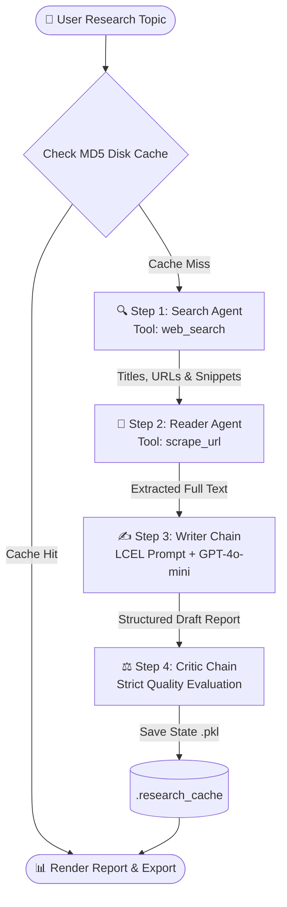

Top open-source AI repositories (like LangGraph, CrewAI, and `Best-README-Template`) stand out from average project documentation by optimizing for immediate visual scanning, reproducibility, and developer onboarding.

### Comparison: Your Draft vs. Best-in-Class GitHub READMEs

| Criteria | Your Current Draft | Best-in-Class Standard | Fixed & Upgraded in Final Version |
| --- | --- | --- | --- |
| **Visual Trust & Header** | Plain H1 title and paragraph. | Centered header with tech badges (Shields.io), Python version, license, and quick navigation links. | Added dynamic Shields.io badges, centered hero header, and quick jump links. |
| **Navigation** | Requires scrolling through the whole file. | Collapsible or linked **Table of Contents** for instant scanning. | Added a linked Table of Contents. |
| **Markdown Syntax** | Missing code fences (`````) around `git clone`, `pip`, `.gitignore`, and the ASCII diagram; broken sub-bullet indentation; stray `gitignore----` text. | 100% compliant GitHub Flavored Markdown (GFM) with language-tagged code blocks for one-click copying. | Fixed every broken fence, indented nested lists, and added `bash`/`env`/`text` syntax tags. |
| **Architecture Diagram** | Plain text with non-breaking spaces (`\u00A0`) that wrap poorly on mobile screens. | Native **Mermaid.js** flowcharts (rendered natively by GitHub) alongside clean ASCII or component tables. | Upgraded to a GitHub-native Mermaid diagram plus a structured Agent Specification table. |
| **Link Integrity** | Broken Google search redirect links (`google.com/search?q=...`) on API Key and License links. | Clean, direct URLs to official docs and repository files. | Replaced all broken redirect URLs with direct links. |
| **Developer Experience** | Covers basic installation and running. | Includes **Demo/Screenshots**, **Sample Output**, **Roadmap**, and **Contributing** guidelines. | Added UI Demo placeholder, Sample Report/Critic output preview, Roadmap, and Contributing steps. |

---

### Complete Production-Ready `README.md`

Copy the raw Markdown block below directly into your repository's `README.md` file:

```markdown
<div align="center">

# 🔬 Multi-Agent Research Assistant

**An autonomous multi-agent web research, synthesis, and peer-review pipeline powered by LangChain, OpenRouter, and Streamlit.**

[](https://www.python.org/)
[](https://github.com/langchain-ai/langchain)
[](https://streamlit.io/)
[](https://openrouter.ai/)
[](LICENSE)

[Overview](#project-overview) • [Architecture](#system-architecture) • [Features](#key-features) • [Installation](#installation-instructions) • [Usage](#how-to-run-the-application) • [Roadmap](#roadmap)

</div>

---

## Table of Contents

- [Project Overview](#project-overview)
- [System Architecture](#system-architecture)
- [Key Features](#key-features)
- [Technologies Used](#technologies-used)
- [Project Structure](#project-structure)
- [Installation Instructions](#installation-instructions)
- [How to Run the Application](#how-to-run-the-application)
- [Sample Output](#sample-output)
- [Roadmap](#roadmap)
- [Contributing](#contributing)
- [License](#license)

---

## Project Overview

Conducting deep topic research manually involves disjointed, repetitive steps: querying search engines, opening dozens of tabs, filtering out low-signal content, synthesizing disparate sources, and reviewing drafts for analytical blind spots.

**Multi-Agent Research Assistant** automates that workflow into a reproducible four-stage pipeline:

1. **Discovery:** Queries the web to gather verified URLs, titles, and contextual snippets using a tool-calling Search Agent.
2. **Extraction:** Dispatches a Reader Agent to select the highest-signal source and scrape clean, full-text content.
3. **Synthesis:** Executes a structured Writer Chain (LCEL) to draft an executive-ready report complete with citations.
4. **Peer Review:** Audits the generated report via an independent Critic Chain that assigns an objective quality score (`X/10`), highlights strengths and weaknesses, and suggests concrete improvements.

> **Demo Preview:** *(Optional: Add a screenshot or GIF of your Streamlit dashboard here, e.g., ``)*

---

## System Architecture

GitHub natively renders the Mermaid workflow below to illustrate how state moves across agents and chains:



### Agent & Chain Specifications

| Stage | Component | Type | Underlying Mechanism | Output State Key |
| :--- | :--- | :--- | :--- | :--- |
| **1** | **Search Agent** | Tool-Calling Agent | `create_agent` + `web_search` | `state["search_results"]` |
| **2** | **Reader Agent** | Tool-Calling Agent | `create_agent` + `scrape_url` | `state["scraped_content"]` |
| **3** | **Writer Chain** | LCEL Pipeline | `writer_prompt \| llm \| StrOutputParser()` | `state["report"]` |
| **4** | **Critic Chain** | LCEL Pipeline | `critic_prompt \| llm \| StrOutputParser()` | `state["feedback"]` |

---

## Key Features

- **Sequential Multi-Agent Handoffs:** Passes structured state cleanly across discovery, reading, writing, and evaluation stages.
- **Full-Text Web Extraction:** Goes beyond shallow search snippets by parsing full webpage bodies for deeper factual grounding.
- **Automated Quality Gate:** Built-in Critic Chain scores every report out of 10 and pinpoints missing context or weak claims.
- **Smart MD5 Disk Caching (`.research_cache/`):** Hashes normalized query strings into local pickle states, eliminating redundant API costs on repeated topics.
- **Interactive Streamlit Workspace:**
  - Real-time progress spinners, status badges, and expandable intermediate step inspectors.
  - One-click topic suggestion chips and persistent sidebar search history (up to 20 recent runs).
  - Multi-format report downloads in **Plain Text (`.txt`)**, **Markdown (`.md`)**, and **JSON (`.json`)**.
- **Dual Execution Modes:** Launch interactively in the browser via Streamlit or run headlessly from the command line.

---

## Technologies Used

- **Orchestration & Agents:** [LangChain](https://github.com/langchain-ai/langchain), LangChain Core (LCEL), LangChain OpenAI
- **Web Interface:** [Streamlit](https://streamlit.io/)
- **LLM Gateway & Model:** [OpenRouter API](https://openrouter.ai/) (`openai/gpt-4o-mini`, temperature `0`)
- **Search & Web Scraping:** Tavily Search API, `requests`, `beautifulsoup4`
- **Caching & Environment:** `python-dotenv`, `hashlib`, `pickle`, `pathlib`

---

## Project Structure

```text
multi-agent-system/
│
├── app.py                  # Streamlit web UI, session state, and disk cache manager
├── agents.py               # Agent builders, LCEL chains, prompts, and CLI runner
├── tools.py                # Custom LangChain tools (web_search, scrape_url)
├── requirements.txt        # Python package dependencies
├── .env.example            # Template for required API keys
├── .gitignore              # Ignored virtualenvs, secrets, and cache directories
└── .research_cache/        # Auto-generated local cache store (.pkl files)
```

---

## Installation Instructions

### Prerequisites

- **Python 3.10** or higher
- An active [OpenRouter API Key](https://openrouter.ai/keys)
- An active [Tavily API Key](https://tavily.com/) *(if using Tavily inside `tools.py`)*

### 1. Clone the Repository

```bash
git clone https://github.com/<your-username>/multi-agent-research-system.git
cd multi-agent-research-system
```

### 2. Create and Activate a Virtual Environment

```bash
# macOS / Linux
python3 -m venv venv
source venv/bin/activate

# Windows (PowerShell)
python -m venv venv
.\venv\Scripts\Activate.ps1

# Windows (Command Prompt)
python -m venv venv
.\venv\Scripts\activate.bat
```

### 3. Install Dependencies

```bash
pip install --upgrade pip
pip install -r requirements.txt
```

### 4. Configure Environment Variables

Create a `.env` file in the project root directory:

```bash
cp .env.example .env
```

Open `.env` and add your API keys:

```env
OPENROUTER_API_KEY=your_openrouter_api_key_here
TAVILY_API_KEY=your_tavily_api_key_here
```

---

## How to Run the Application

### Option 1: Streamlit Web Interface (Recommended)

Start the local Streamlit server:

```bash
streamlit run app.py
```

Open `http://localhost:8501` in your browser:
1. **Enter a Topic:** Type any research query into the search bar or click a **Suggestion Chip**.
2. **Generate:** Click **🚀 Generate** (or press `Enter`).
3. **Inspect Steps:** Expand the step containers to view raw search snippets, scraped webpage content, and intermediate outputs.
4. **Export:** Download the final report and critic review as `.txt`, `.md`, or `.json`.

### Option 2: Command-Line Interface (CLI)

Run the pipeline directly in your terminal without launching a browser:

```bash
python agents.py
```

Enter your research topic when prompted to stream execution logs, the final report, and critic feedback directly to standard output.

---

## Sample Output

**Critic Chain Evaluation Format:**

```text
Score: 8.5/10

Strengths:
- Clear synthesis of primary source data into structured sections.
- Accurate attribution of all external URLs gathered during discovery.

Weaknesses:
- Limited quantitative comparison across competing industry approaches.

Suggestions for Improvement:
- Scrape secondary URLs to cross-verify benchmark claims and add a comparison table.
```

---

## Dependencies (`requirements.txt`)

```text
streamlit>=1.35.0
langchain>=0.2.0
langchain-core>=0.2.0
langchain-openai>=0.1.0
tavily-python>=0.3.0
python-dotenv>=1.0.0
pydantic>=2.0.0
requests>=2.31.0
beautifulsoup4>=4.12.0
```

---

## Recommended `.gitignore`

```gitignore
.env
venv/
__pycache__/
*.py[cod]
.research_cache/
.streamlit/
```

---

## Roadmap

- [ ] **Multi-URL Parallel Scraping:** Allow the Reader Agent to scrape top $N$ URLs concurrently rather than a single source.
- [ ] **Self-Reflection Loop:** Automatically route reports scoring below `7/10` back to the Writer Chain using the Critic's suggestions.
- [ ] **PDF Export:** Add formatted PDF generation alongside `.txt`, `.md`, and `.json`.
- [ ] **Model Selector in Sidebar:** Let users switch dynamically between OpenRouter models (Claude, Gemini, Llama, GPT).

---

## Contributing

Contributions, issues, and feature requests are welcome!

1. Fork the repository.
2. Create your feature branch (`git checkout -b feature/self-reflection-loop`).
3. Commit your changes (`git commit -m "Add iterative critic-writer loop"`).
4. Push to the branch (`git push origin feature/self-reflection-loop`).
5. Open a Pull Request.

---

## License

Distributed under the [MIT License](LICENSE).

```